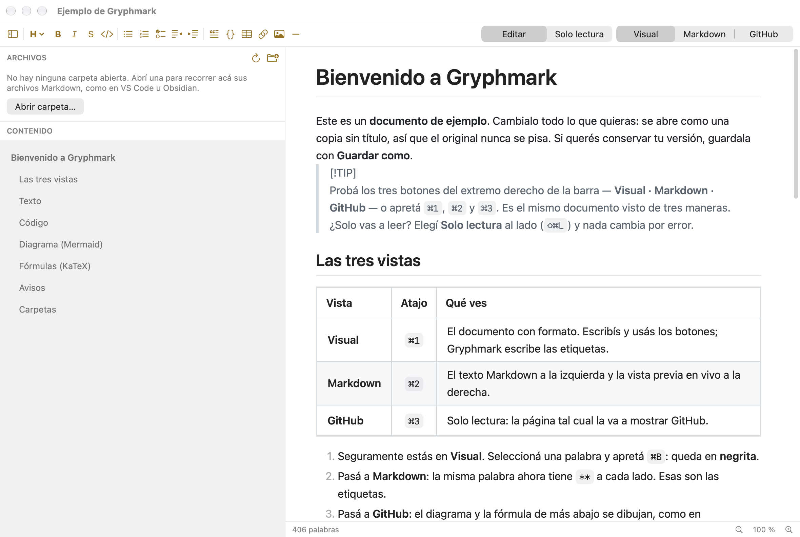
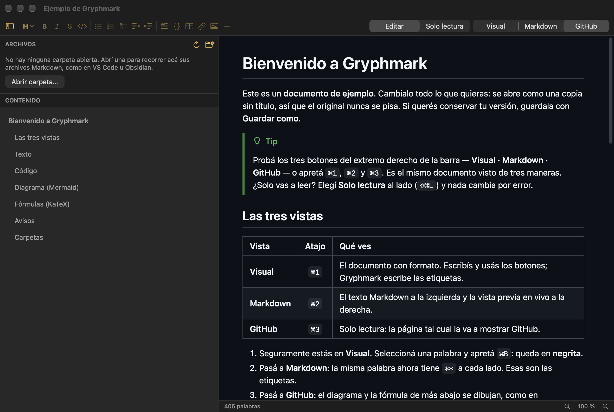

# Gryphmark

Gabriel Castiglia · 10 de noviembre de 2026 · versión 1.0.0 · GPL-2.0-only

[English](README.md) · Español

Repositorio: <https://github.com/Gabriel-Castiglia/gryphmark>

Versión para Windows: <https://github.com/Gabriel-Castiglia/gryphmark-windows>

Manual en PDF: [`docs/Gryphmark-manual-es.pdf`](docs/Gryphmark-manual-es.pdf)

> Solo para macOS 15 o posterior en Apple silicon (arm64). No hay versión para Mac con procesador Intel.

Gryphmark es un visor y editor de Markdown para la Mac. Das formato con botones (títulos, negrita, listas,
tablas, código) y Gryphmark escribe las etiquetas de Markdown por vos; la vista GitHub muestra el documento tal
cual lo muestra GitHub, en claro u oscuro. La interfaz está en español e inglés.

## Recarga en vivo

Cuando otro programa cambia el archivo abierto, por ejemplo un asistente de IA que lo edita, Gryphmark muestra el
texto nuevo enseguida y te deja donde estabas leyendo, en cualquiera de las vistas. Sigue las distintas formas de
guardar: escribir encima del archivo, escribir uno nuevo y renombrarlo encima del viejo, o borrarlo y volver a
escribirlo. Sigue funcionando con la ventana detrás de otras apps, así que el cambio ya está cuando mirás. Si
tenés cambios sin guardar, pregunta antes de reemplazarlos.



## Requisitos

- macOS 15 o posterior en una Mac con Apple silicon. Probado en macOS 27.2.
- Para compilarlo: las Command Line Tools de Apple (`xcode-select --install`). Xcode no hace falta.

## Instalación

Bajá `Gryphmark-<versión>.pkg` de la [página de versiones](https://github.com/Gabriel-Castiglia/gryphmark/releases)
y abrilo. El instalador está en español o inglés, según el idioma de la Mac. Pone `Gryphmark.app` en
`/Applications` y, si había una copia abierta, la cierra antes; instalar un paquete más nuevo conserva la
configuración.

El paquete no está firmado con un Developer ID de Apple, así que la primera vez macOS no lo abre («Apple no
pudo verificar…»). Abrí Configuración del Sistema → Privacidad y seguridad, bajá hasta el aviso sobre
`Gryphmark-<versión>.pkg`, hacé clic en Abrir igualmente y confirmá. Con el archivo `SHA256SUMS.txt` de cada
versión podés comprobar la descarga antes:

```
shasum -a 256 Gryphmark-1.0.0.pkg
```

Gryphmark puede abrir archivos Markdown desde el Finder (clic derecho → Abrir con → Gryphmark) sin quitárselos a
la app que los abre hoy. Para desinstalarlo, cerrá Gryphmark, arrastrá `/Applications/Gryphmark.app` a la
papelera y, si querés borrar también la configuración, corré `defaults delete io.github.gabriel-castiglia.gryphmark`.

## Uso

- Tres vistas del mismo documento (⌘1, ⌘2, ⌘3): Visual, el documento con formato que editás con los botones;
  Markdown, el código con la vista previa en vivo al lado; GitHub, de solo lectura, tal cual lo va a mostrar
  github.com.
- Editar o Solo lectura (⇧⌘L): solo lectura bloquea el texto para que nada cambie por error; igual podés
  seleccionar, copiar, buscar y cambiar de vista.
- La barra y el menú Formato: títulos, negrita, cursiva, tachado, código en línea, listas, listas de tareas,
  sangría, cita, bloque de código, tabla, enlace, imagen y línea horizontal.
- Avisos de GitHub, diagramas Mermaid, fórmulas (KaTeX), notas al pie y emojis en la vista GitHub.
- La barra lateral (⇧⌘E): los archivos Markdown de una o más carpetas (Archivo → Abrir carpeta…) y el índice del
  documento abierto; clic en un título para ir a él.
- Buscar y reemplazar (⌘F, ⌥⌘F, ⌘G), zoom (⌘+, ⌘−, ⌘0), corrector ortográfico, exportar a una página HTML
  autónoma (⌘E), imprimir o guardar como PDF (⌘P).
- Al guardar se respeta tu formato: los bloques que no tocaste conservan su Markdown original, y el archivo
  conserva sus fines de línea (LF o CRLF) y su marca de orden de bytes.
- Si Gryphmark se cierra sin guardar, al volver a abrirlo ofrece recuperar el texto.
- Ver → Tema… (⌘,) elige claro, oscuro o como macOS, y uno de doce colores para el resaltado y el ícono del
  Dock. El ícono en el Finder y en Launchpad sigue dorado, porque cambiarlo rompería la firma de la app.



## Seguridad

Un documento no puede ejecutar nada. El HTML que trae un archivo Markdown se limpia con DOMPurify antes de que la
vista GitHub o una exportación lo muestren. Los enlaces solo abren páginas web, correo, otros archivos Markdown
(en Gryphmark), imágenes y PDF; un enlace a cualquier otro archivo, como un programa o un script, solo lo muestra
en el Finder. La página del editor no llega a nada más que sus propios archivos y la carpeta del documento
abierto.

## Compilar

```
git clone https://github.com/Gabriel-Castiglia/gryphmark.git
cd gryphmark
scripts/compilar.sh          # build/Gryphmark.app
scripts/paquete.sh           # build/Gryphmark-<versión>.pkg
build/Gryphmark.app/Contents/MacOS/Gryphmark --self-test
```

`compilar.sh` firma la app con un certificado propio guardado en su propio llavero, que crea la primera vez,
para que macOS vea la misma app de una compilación a otra y no vuelva a pedir acceso a tus carpetas.
`FIRMA=adhoc scripts/compilar.sh` la firma sin ese certificado, para una prueba rápida. La versión se escribe
solo en `scripts/compilar.sh`.

La autoprueba corre en una ventana real con la página real: el ejemplo, el cambio de tamaño, el tema oscuro, un
diagrama Mermaid, un documento hostil (no puede correr ningún script), las reglas de los enlaces, guardar byte por
byte con BOM y CRLF, la recarga en vivo al reemplazar, borrar y volver a crear, escribir y guardar muchas veces
seguidas, los cambios sin guardar conservados, y la exportación a HTML.

La página del editor (`web/`) es la de la versión para Windows. Sus bibliotecas (`web/lib`) se arman con esbuild
desde `_npm/` con `scripts/web.sh`, que necesita Node.js; el paquete del repositorio se hizo así, con las
versiones exactas de `_npm/package-lock.json`. `scripts/manual.sh` hace los manuales PDF a partir de los dos
README, `scripts/capturas.sh` las imágenes de `docs/img`, y `tools/make_icons.py` el ícono y sus doce colores
(Python con numpy y Pillow).

Las versiones de las herramientas con que se compiló y probó Gryphmark 1.0.0 están en la tabla del
[README en inglés](README.md#building-from-source).

## Estructura

| Carpeta | Contenido |
|---|---|
| `Sources/` | La app (Swift, AppKit, SwiftUI y WebKit) |
| `web/` | La página del editor y sus bibliotecas, compartidas con la versión para Windows |
| `_npm/` | Las dependencias web y la entrada de esbuild |
| `samples/` | El documento de ejemplo, en español e inglés |
| `assets/`, `icono/` | El grabado del grifo, el ícono y sus doce colores |
| `instalador/` | Las páginas y el script del paquete instalador |
| `scripts/` | Compilar, empaquetar, paquete web, manuales e imágenes |
| `tools/` | Dibujo del ícono |
| `docs/` | Manuales PDF e imágenes |

## Licencia y créditos

Copyright (C) 2026 Gabriel Castiglia. Gryphmark es software libre bajo la GNU General Public License, versión 2
únicamente (GPL-2.0-only); ver [`LICENSE`](LICENSE). Se distribuye sin ninguna garantía.

| Componente | Licencia |
|---|---|
| TOAST UI Editor, ProseMirror, marked (+ extensiones alert, footnote, katex), github-markdown-css, Mermaid, KaTeX, gemoji | MIT |
| highlight.js, jsdiff | BSD-3-Clause |
| DOMPurify | MPL-2.0 (usado bajo la opción MPL-2.0 de su doble licencia MPL-2.0 / Apache-2.0) |
| Ícono: el grifo del grabado de Martin Schongauer (c. 1485), Museo Metropolitano de Arte, con una pluma agregada | CC0 |
