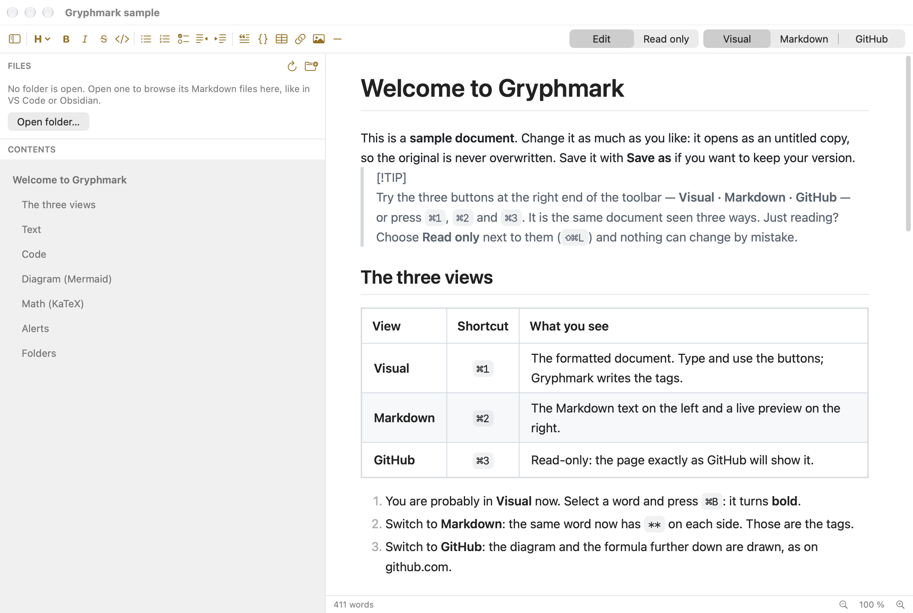
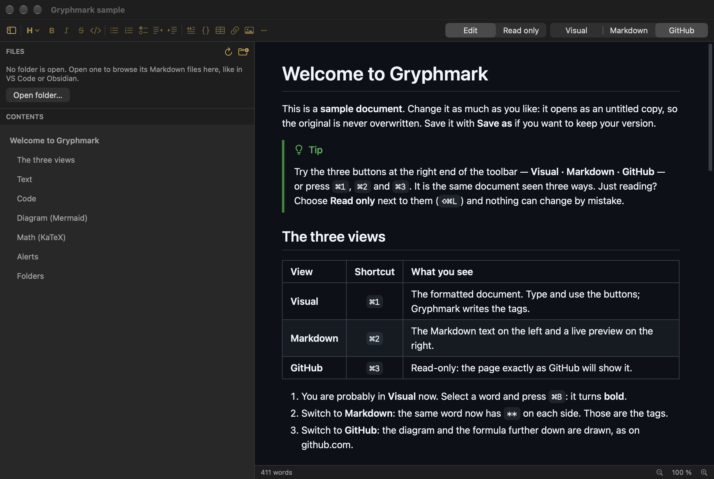

# Gryphmark

Gabriel Castiglia · November 10, 2026 · version 1.0.0 · GPL-2.0-only

English · [Español](README.es.md)

Repository: <https://github.com/Gabriel-Castiglia/gryphmark>

Windows version: <https://github.com/Gabriel-Castiglia/gryphmark-windows>

PDF manual: [`docs/Gryphmark-manual-en.pdf`](docs/Gryphmark-manual-en.pdf)

> macOS 15 or later on Apple silicon (arm64) only. There is no build for Macs with an Intel processor.

Gryphmark is a Markdown viewer and editor for the Mac. You format with buttons (headings, bold, lists, tables,
code) and Gryphmark writes the Markdown tags for you; the GitHub view shows the document exactly as GitHub does,
in light or dark. The interface is in English and Spanish.

## Live reload

When another program changes the open file, such as an AI assistant editing it, Gryphmark shows the new text at
once and keeps you where you were reading, in every view. It follows the ways programs save: writing over the
file, writing a new file and renaming it over the old one, or deleting it and writing it again. It keeps running
while the window is behind other apps, so the change is already there when you look. If you have unsaved
changes, Gryphmark asks before replacing them.



## Requirements

- macOS 15 or later on a Mac with Apple silicon. Tested on macOS 27.2.
- To build from source: Apple's Command Line Tools (`xcode-select --install`). Xcode is not needed.

## Installation

Download `Gryphmark-<version>.pkg` from the
[releases page](https://github.com/Gabriel-Castiglia/gryphmark/releases) and open it. The installer speaks
English or Spanish, following the language of the Mac. It puts `Gryphmark.app` in `/Applications`, closing a
running copy first; installing a newer package keeps the settings.

The package is not signed with an Apple Developer ID, so the first time macOS refuses to open it ("Apple
could not verify…"). Open System Settings → Privacy & Security, scroll to the message about
`Gryphmark-<version>.pkg`, click Open Anyway and confirm. The `SHA256SUMS.txt` file of each release lets you
check the download first:

```
shasum -a 256 Gryphmark-1.0.0.pkg
```

Gryphmark can open Markdown files from the Finder (right-click → Open With → Gryphmark) without taking them over
from the app that opens them now. To uninstall, quit Gryphmark, drag `/Applications/Gryphmark.app` to the Trash
and, to remove the settings too, run `defaults delete io.github.gabriel-castiglia.gryphmark`.

## Using it

- Three views of the same document (⌘1, ⌘2, ⌘3): Visual, the formatted document you edit with the buttons;
  Markdown, the source with a live preview beside it; GitHub, read only, as github.com will show it.
- Edit or Read only (⇧⌘L): read only locks the text so nothing changes by mistake; you can still select, copy,
  find and switch views.
- The toolbar and the Format menu: headings, bold, italic, strikethrough, inline code, lists, task lists,
  indent, quote, code block, table, link, picture and horizontal rule.
- GitHub alerts, Mermaid diagrams, math (KaTeX), footnotes and emoji in the GitHub view.
- The sidebar (⇧⌘E): the Markdown files of one or more folders (File → Open folder…) and the contents of the
  open document; click a heading to go to it.
- Find and replace (⌘F, ⌥⌘F, ⌘G), zoom (⌘+, ⌘−, ⌘0), spell check, export to a self-contained HTML page (⌘E),
  print or save as PDF (⌘P).
- Saving keeps your formatting: blocks you did not touch keep their original Markdown, and the file keeps its
  line endings (LF or CRLF) and its byte order mark.
- If Gryphmark closes without saving, the next start offers the unsaved text back.
- View → Theme… (⌘,) chooses light, dark or as macOS, and one of twelve colours for the highlights and the icon
  in the Dock. The icon in Finder and Launchpad stays gold, because changing it would break the app's signature.



## Safety

A document cannot run anything. The HTML inside a Markdown file is cleaned with DOMPurify before the GitHub view
or an export shows it. Links open only web pages, e-mail, other Markdown files (in Gryphmark), pictures and PDFs;
a link to any other file, such as a program or a script, only shows it in the Finder. The page of the editor
reaches nothing but its own files and the folder of the open document.

## Building from source

```
git clone https://github.com/Gabriel-Castiglia/gryphmark.git
cd gryphmark
scripts/compilar.sh          # build/Gryphmark.app
scripts/paquete.sh           # build/Gryphmark-<version>.pkg
build/Gryphmark.app/Contents/MacOS/Gryphmark --self-test
```

`compilar.sh` signs the app with a self-issued certificate kept in its own keychain, created on the first run,
so macOS sees the same app from one build to the next and does not ask again for access to your folders.
`FIRMA=adhoc scripts/compilar.sh` signs it without that certificate, for a quick test. The version is written
only in `scripts/compilar.sh`.

The self-test runs in a real window with the real page: the sample, resizing, the dark theme, a Mermaid diagram,
a hostile document (no script may run), the link rules, saving byte for byte with BOM and CRLF, live reload by
replacing, deleting and re-creating, writing and a burst of saves, unsaved changes kept, and HTML export.

The editor page (`web/`) is the one of the Windows version. Its libraries (`web/lib`) are bundled with esbuild
from `_npm/` by `scripts/web.sh`, which needs Node.js; the bundle in the repository was made that way, with the
exact versions in `_npm/package-lock.json`. `scripts/manual.sh` makes the PDF manuals from the two READMEs,
`scripts/capturas.sh` the pictures in `docs/img`, and `tools/make_icons.py` the icon and its twelve colours
(Python with numpy and Pillow).

Gryphmark 1.0.0 was built and checked with:

| Tool | Version |
|---|---|
| macOS | 27.2 (arm64, Apple M3) |
| Command Line Tools / Swift | 27.2 / Swift 6.4.2 |
| pandoc (manuals) | 3.13 |
| Google Chrome (manuals) | 157.0.8103.39 |
| Python (icons) | 3.13.17 with numpy 2.5.4 and Pillow 12.3.0 |
| Node.js / npm (web bundle, built for the Windows version) | 26.12.1 / 11.20.0, esbuild 0.25.5 |

Web libraries: TOAST UI Editor 3.2.2, marked 15.0.12, KaTeX 0.19.1, Mermaid 12.3.0, highlight.js 11.11.1,
jsdiff 9.0.0, DOMPurify 3.4.17, github-markdown-css 5.8.1, gemoji 8.1.0.

## Project layout

| Path | Content |
|---|---|
| `Sources/` | The app (Swift, AppKit, SwiftUI and WebKit) |
| `web/` | The editor page and its libraries, shared with the Windows version |
| `_npm/` | The web dependencies and the esbuild entry |
| `samples/` | The sample document, in English and Spanish |
| `assets/`, `icono/` | The griffin engraving, the icon and its twelve colours |
| `instalador/` | The pages and the script of the installer package |
| `scripts/` | Build, package, web bundle, manuals and pictures |
| `tools/` | Icon drawing |
| `docs/` | PDF manuals and pictures |

## License and credits

Copyright (C) 2026 Gabriel Castiglia. Gryphmark is free software under the GNU General Public License, version 2
only (GPL-2.0-only); see [`LICENSE`](LICENSE). It comes with no warranty.

| Component | License |
|---|---|
| TOAST UI Editor, ProseMirror, marked (+ alert, footnote, katex extensions), github-markdown-css, Mermaid, KaTeX, gemoji | MIT |
| highlight.js, jsdiff | BSD-3-Clause |
| DOMPurify | MPL-2.0 (used under the MPL-2.0 option of its MPL-2.0 / Apache-2.0 dual licence) |
| Icon: the griffin of Martin Schongauer's engraving (c. 1485), The Metropolitan Museum of Art, with a quill added | CC0 |
